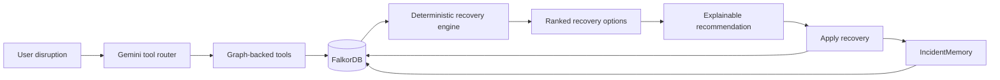
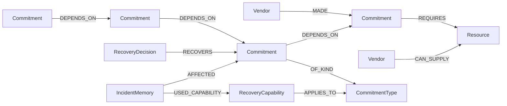

# PromiseGraph

> **When reality breaks a commitment, PromiseGraph finds the least-damaging feasible recovery — and shows the graph path behind the decision.**

**Graph Hacks: Context for AI Agents · WeMakeDevs × FalkorDB**  
**Tracks:** Track 1 — Agents That Act on Connected Data · Track 2 — Agent Memory & Coordination

PromiseGraph is a graph-grounded operational recovery agent for situations where one disruption can cascade across suppliers, resources, production, launches, deliveries, budgets, and deadlines.

Instead of asking an LLM to reason over a flat blob of company data, PromiseGraph gives the agent a connected operational graph in **FalkorDB**. Gemini chooses which graph-backed tool to call next; FalkorDB supplies the connected facts; deterministic recovery logic checks feasibility; and the final action can be written back into the graph as both a recovery decision and persistent incident memory.

---

## The problem

A failed commitment rarely stays isolated.

A supplier outage can delay a component. That component can delay production. Production can delay a launch. The launch can then threaten a customer delivery. At each step, a recovery that looks good locally may violate a budget, exceed a delay tolerance, or create a worse downstream impact.

Traditional agent flows often give the model disconnected records and expect it to reconstruct those relationships itself. PromiseGraph instead stores the relationships explicitly and lets the agent **follow the graph**.

The core question is:

> **Given a disruption, what can still be saved — under the current constraints — with the least damage?**

---

## What PromiseGraph does

A user can describe a disruption in natural language, for example:

```text
Production cannot be completed by Saturday.
```

PromiseGraph then:

1. resolves the disruption to a graph entity;
2. identifies the affected commitment;
3. traverses multi-hop `DEPENDS_ON` relationships;
4. retrieves persistent prior incident memory for that commitment;
5. loads live recovery capabilities, supplier facts, budget and timing constraints from FalkorDB;
6. generates and deterministically checks recovery options;
7. ranks feasible options and recommends the least-damaging route;
8. exposes the exact tool route, graph evidence path and feasibility checks;
9. applies the selected recovery back into FalkorDB;
10. records the incident as persistent organizational memory for future sessions.

---

## Why a graph is central

FalkorDB is not a visualization layer in PromiseGraph. It is the operational context and memory layer that the product depends on.

Without FalkorDB, PromiseGraph loses:

- multi-hop dependency traversal;
- connected supplier/resource context;
- recovery capabilities attached to commitment types;
- live budget and timing constraints;
- explainable evidence paths;
- applied recovery decisions;
- persistent incident memory across sessions.

The graph therefore changes both **what the agent knows** and **what action it can take**.

---

## Track 1 — Agents That Act on Connected Data

PromiseGraph uses connected operational data to decide and act.

### Multi-hop reasoning

A failed commitment is not evaluated in isolation. PromiseGraph traverses downstream dependencies such as:

```text
Complete production by Saturday
        ↓
Launch product Monday
        ↓
Deliver Customer A order Tuesday
```

The same traversal is used to surface downstream blast radius and to propagate recovery delay through connected commitments.

### Graph tools inside the agent loop

Gemini is used as a **tool-selection/router layer**, not as the source of company facts.

A typical live route is:

```text
resolve_graph_entity
→ trace_impact
→ retrieve_prior_incidents
→ analyze_recovery
```

The route can vary depending on what the previous tool returned. For example, when the disrupted entity is not already a commitment, the router can first call `find_related_commitments` before tracing impact.

### Deterministic feasibility

The LLM does not decide whether a recovery is feasible by intuition.

PromiseGraph checks graph-backed facts such as:

- recovery cost vs. budget;
- supplier capacity vs. required quantity;
- supplier availability;
- supplier lead time;
- recovery delay;
- downstream warning thresholds;
- downstream maximum delay limits;
- connected commitment priority and penalty context.

This keeps the recommendation grounded in the current graph rather than model guesswork.

### Action + writeback

When the user selects **Apply recommended recovery**, PromiseGraph writes a `RecoveryDecision` into FalkorDB and connects it back to the recovered commitment. Supplier-based decisions can also be connected to the vendor used.

---

## Track 2 — Persistent episodic memory

PromiseGraph stores applied incidents as graph-native `IncidentMemory` nodes in the same FalkorDB graph.

Each memory stores historical context such as:

- affected commitment;
- incident time;
- recovery ID and name;
- recovery cost;
- recovery delay;
- application outcome.

Memories are linked back to the commitment and, where applicable, to the recovery capability or vendor used.

### Memory survives the next session

Scenario reset deliberately clears transient incident state and recovery decisions **without deleting `IncidentMemory` nodes**.

On a later incident, the agent retrieves prior memory before completing the recovery analysis.

The important design choice is:

> **Memory informs the decision; it does not override current reality.**

For example, PromiseGraph can remember that an overtime recovery previously cost ₹8,000. If that same capability now costs ₹25,000 while the live recovery budget is ₹20,000, the agent still retrieves the old memory — but the current graph rejects that option and recommends a different feasible recovery instead.

That gives PromiseGraph persistent organizational learning without blindly replaying old decisions.

---

## Architecture



### Responsibility split

**Gemini decides what to ask.**  
It selects the next graph-backed tool from the disruption and previous tool results.

**FalkorDB determines what facts exist and how they are connected.**  
Operational state, dependencies, constraints, capabilities, decisions and memory live in the graph.

**PromiseGraph's deterministic recovery engine decides whether a recovery is feasible.**  
Budget, capacity and timing checks are code-driven and graph-grounded.

This separation is intentional: the model orchestrates; the graph grounds; deterministic logic validates.

---

## Graph data model



### Core node types

| Node | Purpose |
|---|---|
| `Commitment` | Business obligation with priority, penalty and timing tolerance |
| `Vendor` | Supplier or external operational dependency |
| `Resource` | Required component/resource and quantity |
| `CommitmentType` | Connects a commitment to applicable recovery capabilities |
| `RecoveryCapability` | Company-configured recovery action with cost and delay |
| `Constraint` | Live operational constraint such as emergency recovery budget |
| `RecoveryDecision` | Applied action written back into FalkorDB |
| `IncidentMemory` | Persistent episodic memory of a prior applied recovery |

### Important relationships

`DEPENDS_ON`, `REQUIRES`, `CAN_SUPPLY`, `OF_KIND`, `APPLIES_TO`, `RECOVERS`, `AFFECTED`, `USED_CAPABILITY`, and `USED_VENDOR`/vendor-use links where applicable.

Representative Cypher used by the project is collected in [`queries.cypher`](./queries.cypher).

---

## Demo scenario

The included synthetic graph models a compact supply → production → launch → delivery chain.

### Commitments

- **C1** — Deliver 100 components by Friday
- **C2** — Complete production by Saturday
- **C3** — Launch product Monday
- **C4** — Deliver Customer A order Tuesday

### Example recovery capabilities

- Run overtime production shift
- Outsource production to partner plant
- Use premium emergency production line
- Switch to phased product launch
- Reschedule full product launch
- Use express delivery partner
- Split order across last-mile partners

The data is intentionally synthetic so the graph can be safely reproduced and modified during judging.

---

## Strong Track 2 demo

A useful way to demonstrate memory is:

**Session 1**

```text
C2 disruption
→ overtime recovery is feasible at ₹8,000
→ recovery applied
→ IncidentMemory written to FalkorDB
```

**Session 2**

Change the live graph so the same overtime capability now costs ₹25,000 while the budget is ₹20,000.

```text
same C2 disruption
→ prior ₹8,000 overtime memory is retrieved
→ current graph is re-evaluated
→ overtime is now infeasible
→ ₹18,000 outsourcing recovery is recommended instead
```

This demonstrates that the agent remembers across sessions while still grounding every new decision in current connected data.

---

## Tech stack

- **FalkorDB** — primary graph database, operational context and persistent memory
- **Cypher** — graph traversal, context retrieval and graph writeback
- **Python** — backend, recovery engine and agent tools
- **Gemini** — dynamic function/tool-selection layer
- **HTML / CSS / JavaScript** — frontend
- **Cytoscape.js** — interactive graph visualization
- **Docker** — local FalkorDB runtime

No separate vector database or memory database is required for the current implementation.

---

## Local setup

### Prerequisites

- Python 3.11+
- Docker Desktop / Docker Engine
- Git
- A Gemini API key for the full dynamic router experience

> The application has a deterministic FalkorDB-grounded fallback when Gemini is unavailable. For the full hackathon demo, use a Gemini API key so the dynamic agent tool route is visible.

### 1. Clone the repository

```bash
git clone <YOUR_REPOSITORY_URL>
cd PromiseGraph
```

### 2. Start FalkorDB

```bash
docker run -d --name falkordb -p 6379:6379 -p 3000:3000 falkordb/falkordb:latest
```

Check that the container is running:

```bash
docker ps
```

FalkorDB Browser is available at:

```text
http://localhost:3000
```

### 3. Create a Python environment

**Windows PowerShell**

```powershell
python -m venv .venv
Set-ExecutionPolicy -Scope Process -ExecutionPolicy Bypass
.\.venv\Scripts\Activate.ps1
python -m pip install -r requirements.txt
```

**macOS / Linux**

```bash
python3 -m venv .venv
source .venv/bin/activate
python -m pip install -r requirements.txt
```

### 4. Seed the synthetic demo graph

```bash
python seed_graph.py
```

### 5. Set the Gemini key

Never commit a real API key to GitHub.

**Windows PowerShell**

```powershell
$env:GEMINI_API_KEY="YOUR_GEMINI_API_KEY"
```

**macOS / Linux**

```bash
export GEMINI_API_KEY="YOUR_GEMINI_API_KEY"
```

### 6. Start the PromiseGraph backend

```bash
python main.py
```

Backend:

```text
http://127.0.0.1:8000
```

### 7. Start the frontend

Open a second terminal from the repository root:

```bash
python -m http.server 5500 --directory frontend
```

Then open:

```text
http://127.0.0.1:5500
```

---

## Suggested first test

Enter this disruption in the PromiseGraph Agent panel:

```text
Production cannot be completed by Saturday.
```

A successful Gemini-backed run should show a route similar to:

```text
resolve_graph_entity
→ trace_impact
→ retrieve_prior_incidents
→ analyze_recovery
```

You should also see:

- affected downstream commitments;
- organizational memory, when a prior incident exists;
- evaluated recovery options;
- budget/timing feasibility checks;
- recommended recovery;
- graph evidence path;
- an **Apply recommended recovery** action.

---

## Company context is live

The frontend includes a **Company Context** panel. Recovery budget, supplier capacity/cost/lead time, and recovery capability cost/delay can be changed without editing source code.

Those values are written into FalkorDB and affect the next recommendation.

This makes the demo useful for testing counterfactuals such as:

> “The same recovery worked last time — does it still work under today's constraints?”

---

## API overview

| Method | Endpoint | Purpose |
|---|---|---|
| `GET` | `/commitments` | Current commitment state |
| `GET` | `/graph` | Graph data for visualization |
| `GET` | `/context` | Live company context |
| `GET` | `/recovery/{id}` | Recovery analysis for a commitment |
| `POST` | `/agent` | Natural-language disruption analysis |
| `POST` | `/context` | Update graph-backed company context |
| `POST` | `/apply/{id}` | Apply recommended recovery and record memory |
| `POST` | `/reset` | Reset transient scenario state while preserving incident memory |
| `POST` | `/fail/{id}` | Manually fail a commitment for testing |

---

## Repository structure

```text
PromiseGraph/
├── agent.py               # Graph operations + deterministic fallback agent
├── llm_agent.py           # Gemini tool router + resilient fallback
├── memory_store.py        # Persistent IncidentMemory read/write logic
├── recovery_engine.py     # Recovery generation, feasibility and ranking
├── main.py                # HTTP API
├── seed_graph.py          # Synthetic FalkorDB demo graph
├── queries.cypher         # Representative Cypher used by the project
├── requirements.txt
├── .gitignore
├── README.md
└── frontend/
    ├── index.html
    └── cytoscape.min.js
```

---

## Reliability / fallback behavior

Gemini is an orchestration layer, not a single point of failure for the graph reasoning core.

PromiseGraph includes a deterministic fallback path so graph-grounded impact and recovery analysis can continue when the Gemini API is unavailable. Transient Gemini failures are retried before fallback, and persistent incident memory remains available from FalkorDB.

---

## What is intentionally deterministic

For an operational recovery system, some decisions should not be left to free-form model reasoning.

PromiseGraph therefore keeps these checks deterministic:

- capacity sufficiency;
- budget compliance;
- delay propagation;
- maximum-delay violations;
- supplier availability;
- feasible-option ranking.

Gemini chooses the investigation/tool route; it does not get to invent operational constraints or waive them.

---

## Cypher

See [`queries.cypher`](./queries.cypher) for judge-readable examples covering:

- multi-hop `DEPENDS_ON` traversal;
- supplier/resource recovery context;
- recovery capability lookup;
- budget retrieval;
- explainable evidence paths;
- applied decision writeback;
- persistent incident-memory retrieval;
- memory relationship inspection.

---

## Security notes

- No real Gemini API key is stored in this repository.
- `.env`, local virtual environments and Python cache files should be excluded through `.gitignore`.
- The included graph data is synthetic demo data.
- The default local FalkorDB setup is intended for local judging/development; production deployments should use authentication, network restrictions and persistent storage.

---

## AI assistance disclosure

AI assistance was used during development for architecture discussion, implementation assistance, debugging and code review. The participant remained responsible for the project concept, graph model, implementation decisions, testing, verification, integration and understanding of the submitted code.

At runtime, Gemini is used specifically as the agent's tool-selection/router layer. FalkorDB remains the source of operational context and persistent memory, while PromiseGraph's deterministic logic performs feasibility validation.

---

## Hackathon alignment

PromiseGraph was built for **Graph Hacks: Context for AI Agents**, where FalkorDB must be the primary graph database and the graph must perform central product work.

- **Track 1:** the agent follows connected data, performs multi-hop impact analysis, selects graph-backed tools, acts on graph results and exposes an explainable path.
- **Track 2:** the agent writes episodic incident memory into FalkorDB, retrieves it in later sessions and uses it as historical context while re-evaluating current graph constraints.

Hackathon: https://www.wemakedevs.org/hackathons/falkordb

---

## Demo links

<!-- Replace these two lines before the final hackathon submission. -->

- **Demo video:** _to be added before submission_
- **Live demo:** _local setup is fully supported; hosted deployment may be added before submission_

---

## One-line takeaway

> **PromiseGraph remembers what worked before, sees what changed now, and chooses the recovery that still makes sense.**